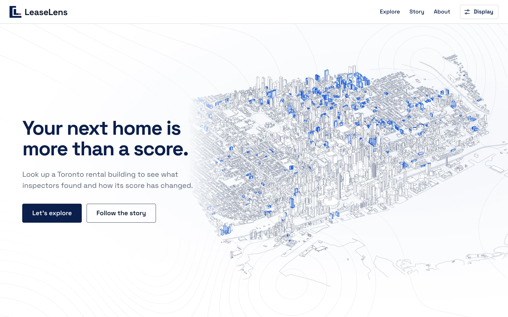
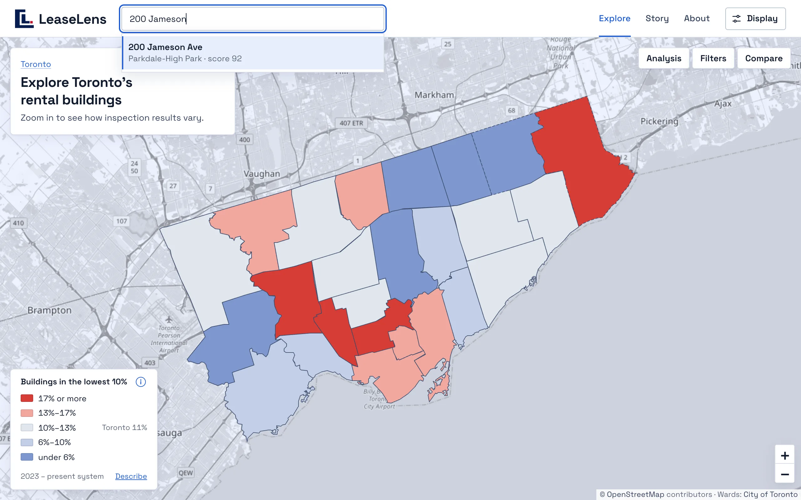
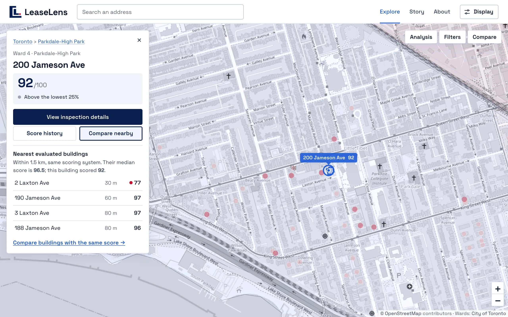
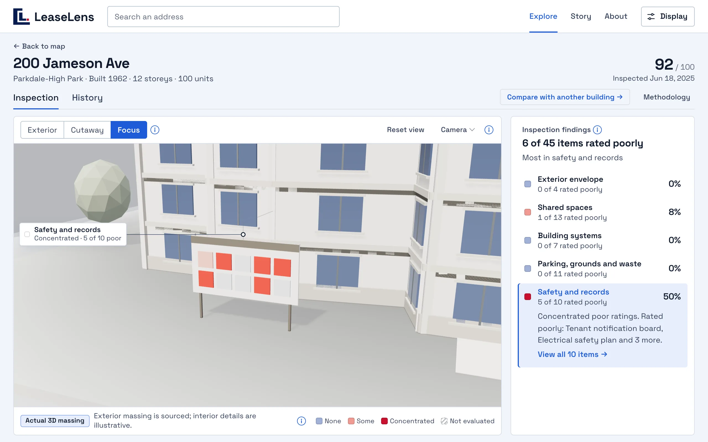
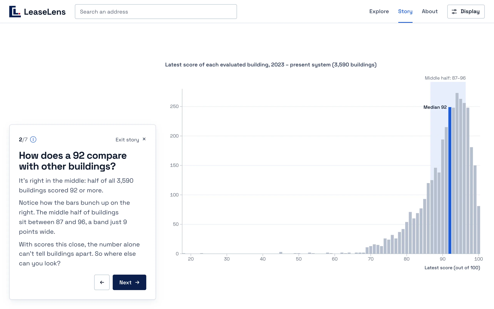
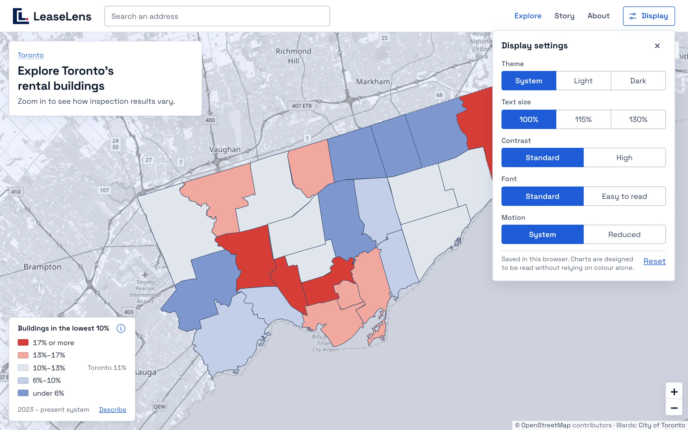

# LeaseLensTO

A visual guide to Toronto’s rental building inspections, created by Reena Obmina, Tess Madison, and Hargun Badhesha for **CSC316: Data Visualization** at the University of Toronto.

 It draws on the City of Toronto’s **RentSafeTO** apartment building evaluations to help renters explore inspection scores, see which items need attention, and track how scores change over time.

**[Explore the Application →](https://lease-lens-flame.vercel.app/dashboard/)**



## Contents

1. [What is LeaseLens?](#what-is-leaselens)
2. [The data story](#the-data-story)
   - [Where you look matters](#1-where-you-look-matters)
   - [The same score can hide different issues](#2-the-same-score-can-hide-different-issues)
   - [One inspection is a snapshot](#3-one-inspection-is-a-snapshot)
3. [Features](#features)
   - [Explore and address search](#explore-and-address-search)
   - [Building summary and Compare nearby](#building-summary-and-compare-nearby)
   - [Building X-Ray](#building-x-ray)
   - [Compare buildings](#compare-buildings)
   - [Score History](#score-history)
   - [Guided Story](#guided-story)
   - [Display settings](#display-settings)
4. [How to run LeaseLens](#how-to-run-leaselens)
   - [Use the website](#the-easy-way-use-the-website)
   - [Run it on your own](#run-it-on-your-own-computer)
5. [Libraries used](#libraries-used)
   - [Loaded by the website](#loaded-by-the-website)
   - [Used for development](#used-for-development)
   - [Hosting](#hosting)
6. [Data](#data)
7. [Project folders](#project-folders)
8. [Credits](#credits)

## What is LeaseLens?

When you rent an apartment in Toronto, the City may have inspected the building. Its **RentSafeTO** program checks apartment buildings with three or more storeys or 10 or more units, and gives each one a score out of 100.

LeaseLens helps first-time renters look past that single number. You can search for a building and see where it sits in the city. You can see what the inspectors actually found, and how its score has changed over time.

## The data story

**Your next home is more than a score.**

Most buildings score highly. Half of the 3,590 buildings inspected under the current system scored 92 or more, and the middle half scored between 87 and 96. When so many scores are close together, the number alone doesn't tell you much. LeaseLens shows three things the score hides.

### 1. Where you look matters


*Davenport selected on the map. Red areas have more low-scoring buildings than average; blue areas have fewer. Each circle is a group of buildings, and its red arc is the share in the lowest 10%.*

Low scores are not spread evenly across Toronto. LeaseLens marks a building as being in the city's **lowest-scoring 10%** if its latest score is 81 or below. Because many buildings are tied at 81, this group is 11% of all buildings.

- In **Davenport**, 24 of 92 buildings (**26%**) are in that group, more than twice the city average.
- In **Don Valley West**, only 5 of 170 (**3%**) are.

These figures compare the 21 wards that have at least 50 inspected buildings.

### 2. The same score can hide different issues


*Two buildings with the same score, compared by inspection area. Red bars show the share of items rated low: 200 Jameson Ave on the left, 77 Quebec Ave on the right.*

**200 Jameson Ave** and **77 Quebec Ave** are in the same ward, and both scored **92**. But inspectors found different things.

- At **200 Jameson Ave**, 6 items were rated low (1 out of 3). Five were records the landlord must keep or post: the electrical safety plan, tenant notification board, state of good repair plan, pest control log and vital service plan. The sixth was the hallway walls and ceilings.
- At **77 Quebec Ave**, no items were rated low.

### 3. One inspection is a snapshot


*Score history for 77 Quebec Ave. Scores from the old and new systems are shown side by side but never joined.*

Scores change from one inspection to the next. **77 Quebec Ave** went from **85** in August 2024 to **92** in September 2026. Across the city, a building's next score was higher 64% of the time and lower 29% of the time. That's based on 3,216 pairs of back-to-back inspections.

**Watch out for the 2023 change.** The City changed how it scores buildings in 2023:

| | Before 2023 | Since 2023 |
|---|---|---|
| What is rated | 20 categories | Up to 50 items |
| Rating scale | 1 to 5 | 1 to 3 (0 if an item couldn't be inspected) |

Because the two systems measure different things, their scores can't be compared directly. LeaseLens shows older scores as a separate dashed line and never connects them to newer ones.

## Features

Each feature lists what a renter can use it for. All screenshots show the real website with real City data.

### Explore and address search

**Use it to:** find a building you're considering and see its score in context.


*Start typing an address. Each suggestion shows the building's ward and latest score.*

The map starts with Toronto's 25 wards. Zoom in to see groups of buildings, then single buildings. The ward view appears in [Where you look matters](#1-where-you-look-matters).

### Building summary and Compare nearby

**Use it to:** see how a building compares with others close by.


*200 Jameson Ave scored 92, lower than the typical score of 96.5 for buildings within 1.5 km.*

Click a building to open its summary card. From there you can view the full inspection, its score history, or nearby buildings.

### Building X-Ray

**Use it to:** pick an inspection category and see which items were rated low.


*The X-Ray for 200 Jameson Ave, focused on "Safety and records": 5 of its 10 items were rated low.*

The X-Ray shows one inspection on a 3D model of the building. Choose **Exterior**, **Cutaway** or **Focus** to look around. The building's outline and height are real, from City data. **The inside of the building is for illustration only.** It is not a floor plan, and it doesn't show where problems were found.

### Compare buildings

**Use it to:** compare two buildings side by side, item by item.

Type an address in either search bar, or open **Example pairs** for buildings that share a score. A one-line summary says how the two differ. Three tabs show the pair in more or less detail:

- **By category:** a mirrored bar chart of the share of items rated low in each inspection area. Beside it, both scores are placed on Toronto's score histogram, and each building's items are split by rating.
- **Every item:** every inspected item, with both buildings' ratings side by side.
- **All of Toronto:** each area's share of low ratings across the city, with both buildings marked.

The first building is always navy and on the left; the second is blue and on the right. Every chart has hover tooltips, and the whole view fits the window without scrolling. A screenshot appears in [The same score can hide different issues](#2-the-same-score-can-hide-different-issues).

### Score History

**Use it to:** check whether the latest score is part of a pattern or a sudden change.

Open it from any building's summary card, or from the **History** tab in the X-Ray. It plots every inspection and says how much the score changed since the last one. A screenshot appears in [One inspection is a snapshot](#3-one-inspection-is-a-snapshot).

### Guided Story

**Use it to:** get a short, step-by-step introduction to what the data shows.


*Chapter 2 of 7: half of all buildings scored 92 or more, so most scores sit in a narrow band near the top.*

The story, *Beyond the Score*, asks one question per chapter and walks through the city, one ward, one building, a comparison and a score history in seven chapters. Every number in it is calculated from the data when the page loads.

### Display settings

**Use it to:** make the website easier to read.


*Choose light or dark mode, larger text, higher contrast, an easier-to-read font, or less motion.*

Your choices are saved in your browser. Charts don't rely on colour alone, so they can be read with any colour vision.

## How to run LeaseLens

### Use the website

Open **[lease-lens-flame.vercel.app/dashboard](https://lease-lens-flame.vercel.app/dashboard/)** in any up-to-date browser (Chrome, Firefox, Safari or Edge). There's nothing to install.

### Run it on your own computer

LeaseLens is a plain website: HTML, CSS and JavaScript files with no build step. You only need to serve the folder with a small local web server.

**You need**
- **Python 3**, to run the local web server. Check by typing `python3 --version` in a terminal (`python --version` on Windows).
- **An internet connection.** The map tiles, fonts and the D3, Leaflet and Three.js libraries load from the internet.

**Steps**

1. **Get the code.** Download this repository as a ZIP from GitHub (green **Code** button → **Download ZIP**) and unzip it. Or clone it:
   ```sh
   git clone https://github.com/rmobmina/lease-lens-TO.git
   ```
2. **Open a terminal in the project folder,** the folder that contains `dashboard`, `data` and `shared` (`lease-lens-TO` if you cloned it):
   ```sh
   cd lease-lens-TO
   ```
3. **Start the web server:**
   ```sh
   python3 -m http.server 8000
   ```
   On Windows, use `python -m http.server 8000`.
4. **Open <http://localhost:8000/dashboard/>** in your browser.
5. **To stop the server,** go back to the terminal and press `Ctrl + C`.

## Libraries used

LeaseLens doesn't use a framework, a bundler or a build step. The website loads a few libraries straight from public CDNs, so there's nothing to install to view it. Everything else (the charts, map layers, story and 3D scene) is our own code in `dashboard/js/` and `shared/js/`.

### Loaded by the website

| Library | Version | Loaded from | What it does in LeaseLens | Licence |
|---|---|---|---|---|
| [D3.js](https://d3js.org/) | 7.9.0 | cdnjs | Reads the CSV data and draws every chart: the score histograms, comparisons, score history, story charts and tooltips | ISC |
| [Leaflet](https://leafletjs.com/) (JavaScript and CSS) | 1.9.4 | cdnjs | The Explore map: ward shapes, building groups, single buildings, zoom and pan | BSD 2-Clause |
| [Three.js](https://threejs.org/) | 0.160.0 | jsDelivr | The 3D Building X-Ray. Downloaded only when the X-Ray opens | MIT |
| Three.js `OrbitControls` add-on | 0.160.0 | jsDelivr | Rotating, zooming and panning the 3D building | MIT |
| Three.js `RoomEnvironment` add-on | 0.160.0 | jsDelivr | Soft lighting for the 3D building | MIT |
| [OpenStreetMap](https://www.openstreetmap.org/copyright) map tiles | — | tile.openstreetmap.org | The background street map under the wards and buildings | © OpenStreetMap contributors (ODbL) |
| [Space Grotesk](https://fonts.google.com/specimen/Space+Grotesk) | 400–700 | Google Fonts | The site's typeface | SIL Open Font License |
| [Atkinson Hyperlegible](https://fonts.google.com/specimen/Atkinson+Hyperlegible) | 400, 700 | Google Fonts | The "Easy to read" font in Display settings. Downloaded only when chosen | SIL Open Font License |

### Used for development

These are only needed to run the tests or rebuild the data, not to view the site.

| Tool | Version | What it's used for |
|---|---|---|
| [Node.js](https://nodejs.org/) | 18 or newer (we used 22) | Runs the automated tests (`npm test`) and the syntax check (`npm run check`) |
| Node built-in modules | — | `node:test` and `node:assert` (the test runner), `node:fs`, `node:path`, `node:url`, `node:vm` and `node:child_process` (loading the site's code and data in the tests) |
| [d3](https://www.npmjs.com/package/d3) from npm | ^7.9.0 (in `package.json`) | The same D3 the website uses, so the tests compute numbers exactly as the site does. `npm install` also adds D3's own sub-packages (`d3-array`, `d3-scale` and so on) |
| [Python 3](https://www.python.org/) | Any Python 3 | Serving the site locally, and the data scripts in `scripts/` |
| Python standard library | — | `csv`, `json`, `math`, `statistics`, `struct`, `collections`, `os` and `sys`, for reading the City's files and writing the processed map, 3D and homepage data. No extra packages |

### Hosting

The public website is hosted on [Vercel](https://vercel.com/) as plain static files.

## Data

All data comes from **City of Toronto Open Data**, under the [Open Government Licence – Toronto](https://open.toronto.ca/open-data-licence/).

| File | What it is |
|---|---|
| [`data/apartment_building_evaluations_pre_2023.csv`](data/apartment_building_evaluations_pre_2023.csv) | 11,760 inspections from 2017 to May 2023 (old scoring system) |
| [`data/apartment_building_evaluations_2023_current.csv`](data/apartment_building_evaluations_2023_current.csv) | 6,806 inspections from June 2023 to September 2026 (current scoring system) |

## Project folders

```
lease-lens/
├── dashboard/        The website
│   ├── index.html    The single page that holds every view
│   ├── css/          Styles: colours, type, layout (light and dark themes)
│   ├── js/           The app's code
│   │   ├── main.js       Starts the app, handles navigation between views
│   │   ├── model.js      Turns the inspection records into scores, rankings and comparisons
│   │   ├── atlas/        The Explore map and address search
│   │   ├── home/         The homepage drawing
│   │   ├── sections/     Each view: building card, X-Ray, comparison, analysis panels
│   │   ├── story/        The guided story, Beyond the Score
│   │   └── xray/         The 3D Building X-Ray
│   └── data/         Processed map, 3D and homepage data
├── shared/js/        Loads and cleans the two CSV files (used by the dashboard and the tests)
├── data/             The RentSafeTO CSV files and their field guide
├── scripts/          Python scripts that prepare the processed data
├── tests/            Automated tests, run against the real data
├── story/            An earlier prototype chapter (score changes over time)
└── docs/             Design notes, data notes and screenshots
```

## Credits

**Data** from City of Toronto Open Data, [Open Government Licence - Toronto](https://open.toronto.ca/open-data-licence/):
- [Apartment Building Evaluations (RentSafeTO)](https://open.toronto.ca/dataset/apartment-building-evaluation/): every score and item rating
- [3D Massing](https://open.toronto.ca/dataset/3d-massing/): building outlines and heights for the X-Ray and homepage
- [City Wards](https://open.toronto.ca/dataset/city-wards/): ward boundaries
- [Toronto Centreline](https://open.toronto.ca/dataset/toronto-centreline-tcl/): streets in the homepage drawing

**Base map:** © [OpenStreetMap](https://www.openstreetmap.org/copyright) contributors.

LeaseLens is an independent student project. It is not an official City of Toronto service. The code is released under the [MIT License](LICENSE).
